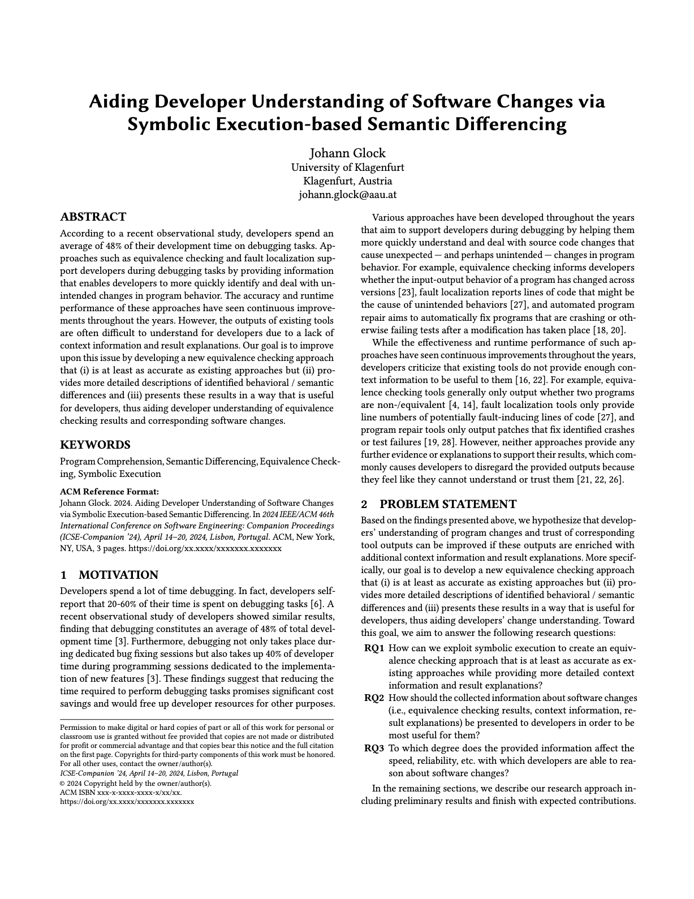

# Aiding Developer Understanding of Software Changes via Symbolic Execution-based Semantic Differencing

LaTeX sources of Johann Glock's paper at the ICSE 2024 Doctoral Symposium ([doi:10.1145/3639478.3639783](https://doi.org/10.1145/3639478.3639783)). The paper, the slides of the talk and the poster are on [glockyco.com](https://glockyco.com/research/icse-2024-doctoral-symposium/).

[main.pdf](main.pdf) is the built paper.



## Build

You need a LaTeX distribution with `latexmk`:

```sh
latexmk -pdf main.tex
```

The repository bundles the `acmart` class the paper was submitted with, which a current TeX Live rejects. Delete `acmart.cls` to build with the installed class instead.

The text is in `content/`, and `content/sources.bib` holds the references.

## Related

- [The poster's LaTeX sources](https://github.com/glockyco/icse2024-docsym-poster)
- [PASDA](https://glockyco.com/research/pasda/), the tool behind the preliminary results

## License

The text of the paper is licensed under [CC BY 4.0](LICENSE). The `acmart` class and its bibliography styles keep their own license.
